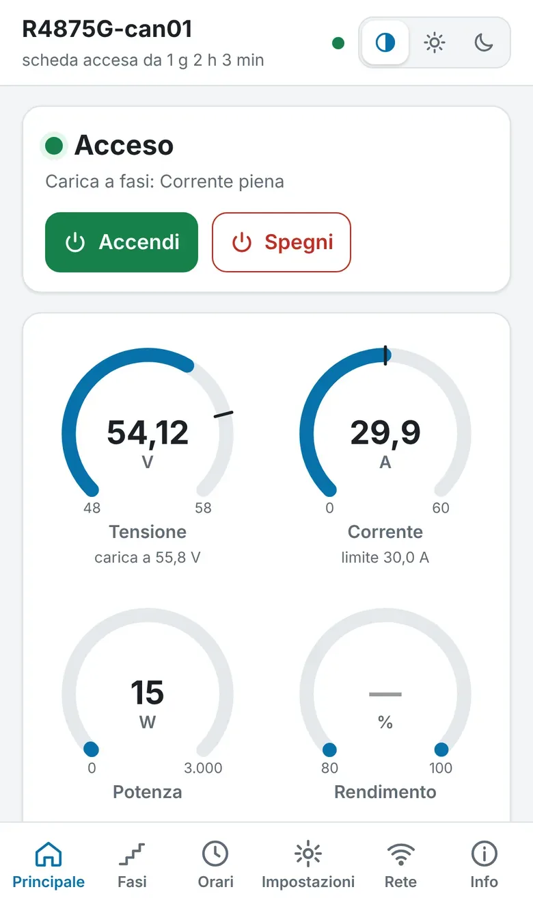
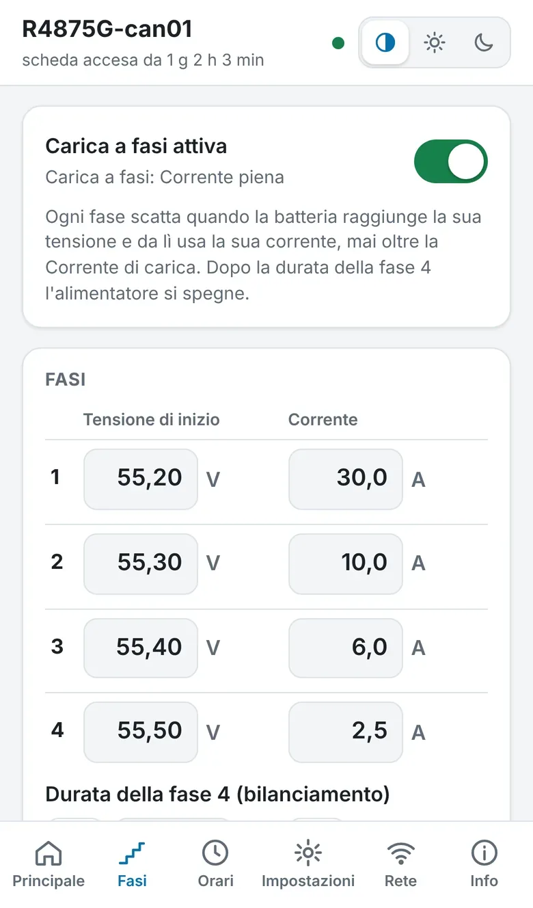
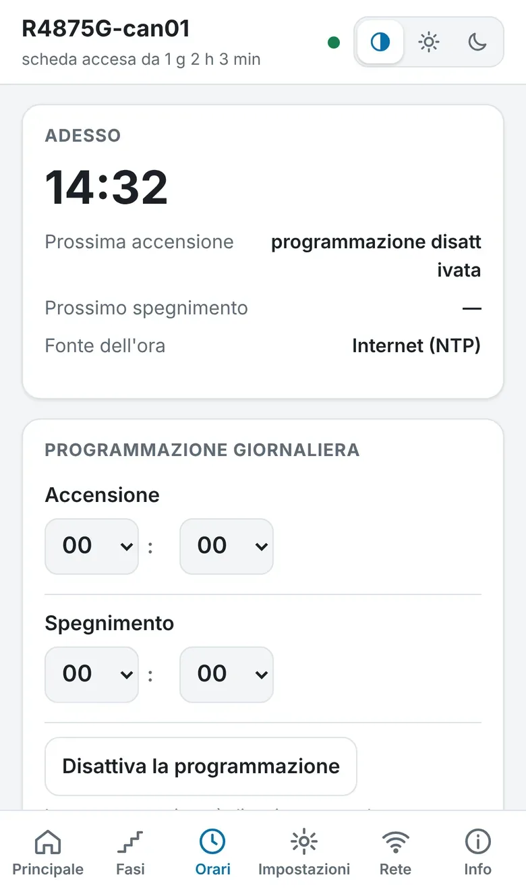
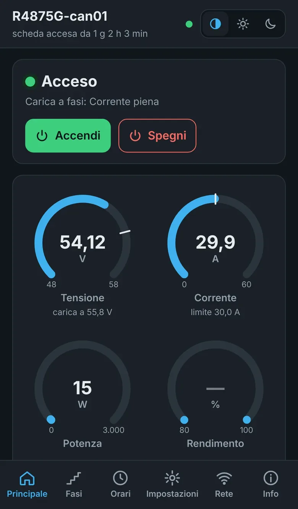

# Alimentatore Huawei R4850G comandato con ESPHome

Firmware per una scheda ESP32 che comanda via bus CAN gli alimentatori Huawei della serie R48xx (R4850G, R4875G e simili) e li trasforma in caricabatterie regolabili per batterie LiFePO4 a 48 V. Tutto si controlla da una pagina web, dal telefono o dal computer; Home Assistant è facoltativo.

Pagina del progetto con foto, componenti e collegamenti: **[quellidelfaidate.it](https://quellidelfaidate.it/)**

## Cosa fa

- Imposta tensione di carica (49–58 V) e corrente, fino al massimo del modello.
- Carica a 4 fasi: la corrente scende a gradini verso la fine e l'alimentatore si spegne da solo. Valori pronti per 16 e 15 celle.
- Accensione e spegnimento a orari fissi, con l'ora presa da internet.
- Misure di tensione, corrente, potenza, temperature, ventola, energia e rendimento.
- Valori di riserva che l'alimentatore usa da solo se perde il contatto con la scheda.
- Rete WiFi, indirizzo IP (automatico o statico) e server dell'ora si cambiano dalla pagina: funziona senza Home Assistant e senza internet.
- Pagina in italiano con tema chiaro, scuro o automatico.

## Schede supportate

| Scheda | File per Home Assistant | File per il browser | CAN TX | CAN RX |
|---|---|---|---|---|
| ESP32-C3 SuperMini (consigliata) | `firmware/r4850g-c3.yaml` | `firmware/r4850g-c3-browser.yaml` | GPIO 4 | GPIO 3 |
| M5Stack ATOM Lite | `firmware/r4850g-atom.yaml` | `firmware/r4850g-atom-browser.yaml` | G22 | G19 |
| ESP32 DevKit | `firmware/r4850g-esp32.yaml` | `firmware/r4850g-esp32-browser.yaml` | D19 | D21 |

Serve un modulo CAN **SN65HVD230 alimentato a 3,3 V** (piedini 3V3, GND, TX, RX). I moduli MCP2515 e quelli con TJA1050 o MCP2551 a 5 V non funzionano con questo firmware.

## Installazione

### Dal browser, senza Home Assistant

Apri la [pagina di installazione](https://tecno-consulenza.github.io/r4850g-esphome/) con Chrome o Edge su un computer, collega la scheda con il cavo USB, scegli il tipo di scheda e premi **Installa**. Alla fine il browser chiede la rete WiFi.
Se lo salti, la scheda crea la rete di emergenza *r4850g-xxxxxx* (password `r4850g-setup`): collegati con il telefono e scegli la tua rete.

La pagina della scheda si apre all'indirizzo che le dà il router oppure su `http://r4850g-xxxxxx.local` (le ultime sei cifre sono quelle del MAC).

### Con ESPHome Device Builder / Home Assistant

1. Copia nella cartella `esphome` di Home Assistant il file yaml della tua scheda e `firmware/r4850g-web.js`.
2. Copia `firmware/secrets.example.yaml` in `secrets.yaml` (o aggiungi le sue righe al `secrets.yaml` che hai già) e metti i tuoi valori.
3. In Device Builder premi **Install**: la prima volta via USB, poi via WiFi.

Il manuale completo in PDF è allegato a ogni [rilascio](https://github.com/tecno-consulenza/r4850g-esphome/releases/latest).

## Statistiche anonime

Alla prima apertura la pagina chiede se inviare una volta al giorno a `statistiche-ha.tecnoconsulenza.it` un codice casuale creato dalla scheda, la versione del firmware, il tipo di scheda, la versione di ESPHome e il modello dell'alimentatore. Servono solo a contare le installazioni in uso. Senza consenso non parte nulla, e la scelta si cambia dalla scheda Info. Nessun valore di carica, nome, password o dato della rete viene inviato.

## Segnalazioni

Anomalie e proposte di nuove funzioni si segnalano dalle [Issues](https://github.com/tecno-consulenza/r4850g-esphome/issues/new/choose), con i moduli già pronti. Il progetto è portato avanti nel tempo libero: le segnalazioni servono a migliorarlo, non sono un servizio di assistenza.

## Sicurezza

Il montaggio comporta la rete a 230 V e correnti continue di decine di ampere su batterie al litio. Usa una presa con terra e differenziale, un fusibile DC adatto ad almeno 60 V vicino alla batteria e cavi della sezione giusta; la batteria deve avere il suo BMS. Se non hai esperienza con impianti elettrici, fatti aiutare da un elettricista.

## Licenza e crediti

Licenza MIT (vedi [LICENSE](LICENSE)). Il firmware parte da [CAN-BUS control R4875G1 with ESPHome and MQTT](https://github.com/mjpalmowski/CAN-BUS-control-R4875G1-with-ESPHome-and-MQTT) di mjpalmowski ed è stato riscritto e ampliato.

Il progetto è condiviso gratuitamente a scopo informativo: firmware e documentazione sono forniti "così come sono", senza garanzie, e chi lo realizza lo fa sotto la propria responsabilità. Huawei, Espressif, M5Stack, ESPHome e Home Assistant sono marchi dei rispettivi proprietari; il progetto non è affiliato a nessuno di loro.
